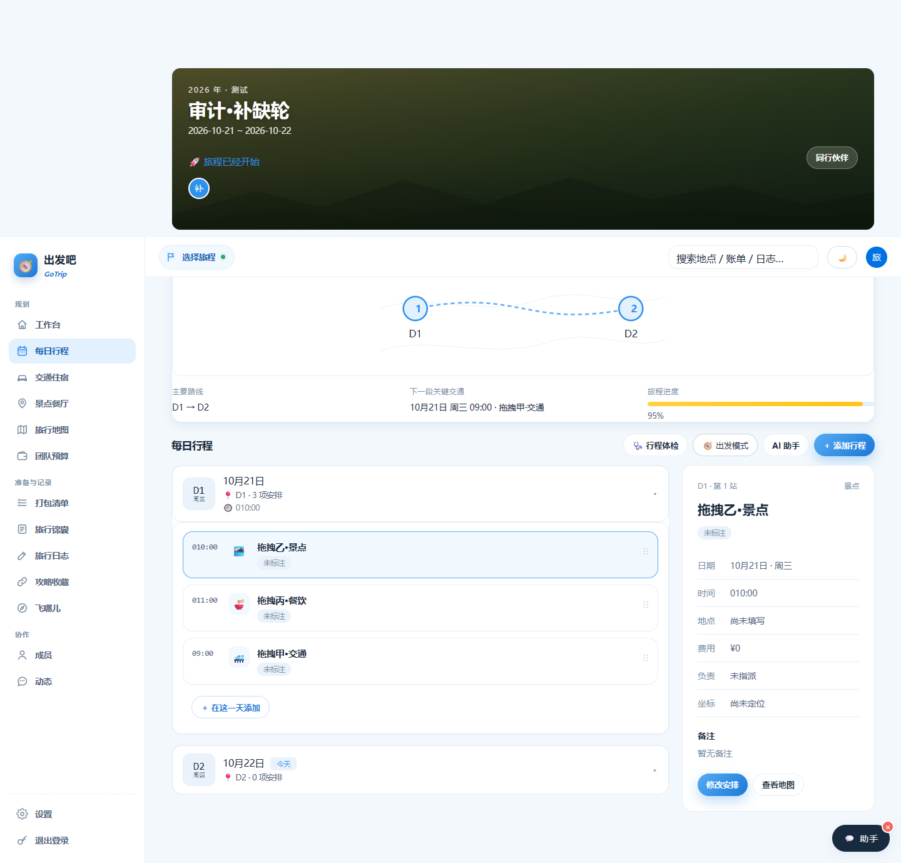

# Web 审计与修复报告（web-audit · 2026-10-21）

> 当前结论（2026-10-22 晚）：主持方独立补测 34/34、类型/构建/API 冒烟通过，详见第 10 节；AI 真调、部分外链与生产部署仍有缺口，整体任务未标完成。前文按执行轮保留历史状态，以最新章节为准。

执行者：ZCode（首轮，17:00 因 1308/429 中断）→ WorkBuddy/deepseek-v4.1-flash（17:25 接续至完成）。协作任务包 web-audit，主持方 Codex。基线 HEAD=74cdfe5，branch=feat/miniprogram。
范围：review 5c20023/7ebe956 的工作台概况面板与时间轴详情 + 现有功能回归；真实浏览器验证。

## 0. 环境与方法

- 本地真实 SQLite API（server 8787，`/health` → `{"ok":true,"db":"sqlite","mode":"fullstack"}`）+ Vite 5174（本包保留端口，接手时已在跑，未重启未打断；`curl` 需 `--noproxy '*'`，本机 HTTP_PROXY 会把 localhost 请求转成 502）+ Edge headless（work/ui-runtime Playwright，channel=msedge）。
- 天气外部请求在浏览器内路由隔离（空数组）；AI 不真调（只测空输入校验，不烧外部额度）。
- 截图目录：`work/web-1021/shots/`；审计脚本：`work/web-1021/audit-web-1021.cjs`（审计模式：失败收集后继续）、控件清单：`inventory-controls-1021.cjs`；探针：`probe-b15-c1.cjs`、`probe-imgreset.cjs`、`probe-unlabeled-btn.cjs`（只读诊断）。旧脚本 `work/verify-panels-1012.cjs` 未改动。
- 测试数据全部为专用行程（标题带「审计/诊断」字样），按 id 走 `deleteTrip` 级联清理，结束时 `gt_trips` 为空；会话已登出。

## 1. 问题清单（先于修复写入，状态为发现时点）

| # | 级别 | 问题 | 位置 | 复现 | 处置 |
|---|------|------|------|------|------|
| W1 | P2 | 无日期行程被标「进行中 · 第 1 天」，且「当前旅程」选取、「在路上等你」统计把无日期行程当作进行中 | `client/src/pages/DashboardPage.tsx` `heroPhase` | 新建行程不填日期 → 工作台横幅徽章「进行中 · 第 1 天」 | 修复：无日期返回「日期待定」（ph-up 配色），不再占用 live 优先级 |
| W2 | P2 | 无日期行程卡片倒计时显示「还有 NaN 天出发」 | `client/src/components/ui.tsx` `countdownText` | 同上 → 行程卡倒计时区 | 修复：无日期返回「日期待定」；「在路上等你」筛选/统计排除无日期 |
| W3 | P2 | 深色主题下概况面板与详情卡的次级按钮（描边/幽灵）`#0066cc` on `#1d1d1f` 对比度 **3.02:1**，14px 文字 WCAG AA 需 4.5:1。7ebe956 把深色统一回 #0066cc 只对浅色成立，DESIGN.md 未定义深色行为（原 5c20023 的 #2997ff 在深色为 5.58:1 达标） | `client/src/styles.css` `.dash-current .btn` 等 | 深色模式打开工作台 → 「每日行程」等描边按钮 | 修复：深色下非 primary 按钮文字改中性 `#f5f5f7`，描边保留 `#0066cc`（见 1.1 方案，实测 15.46:1） |
| W4 | P2 | 跨行程 SPA 导航不重挂载 ItineraryTab（TripPage 内容区 key 只含 tab）：**行程体检结果卡、展开天、选中站等状态跨行程残留**——A 行程的体检结论会显示在 B 行程页上 | `client/src/pages/TripPage.tsx` | 行程页跑「行程体检」→ 顶栏切到另一段旅程 → 上一段的体检卡仍在 | 修复：tab-pane key 加入 tripId，换行程整体重挂载 |
| W5 | P2 | TripCard `imgFailed` 不随 coverImage 更新重置：把坏封面改成可用封面后卡片仍显示 emoji 兜底，整页刷新才恢复（DashHero 同场景已正确重置，两处行为不一致） | `client/src/pages/DashboardPage.tsx` TripCard effect | 卡片封面 404 → 编辑旅程换 data:/可用图 → 卡片仍 emoji | 修复：effect 内补 `setImgFailed(false)` |
| W6 | P3 | 0 天行程的详情卡空态文案「展开一天，选择安排查看详情」——根本没有天可展开，误导 | `client/src/pages/tabs/ItineraryTab.tsx` inspector 空态 | 新建无天行程 → 行程板块右侧详情卡 | 修复：无天时改显示「还没有行程日…」 |
| W7 | P3 | ~~`ThemeToggle` 组件（ui.tsx 导出）无任何挂载点，应用内无主题切换入口~~ **结论有误，已作废**：组件挂在 `TopBar`（ui.tsx:85），顶栏右侧即 🌙/☀️ 按钮；本轮真实点击并新增 D5 断言 | `client/src/components/ui.tsx` | 顶栏右侧主题按钮 | 不成立，无需改代码 |

review 其他观察（不构成问题，已核对）：`?tab=` 非法值回退 itinerary 正常；预算超支钳制与 aria 语义正常；0,0 作为合法坐标出高德链接正常；订单号脱敏正常；`onToggle` 函数式 setState 修复（5c20023）在真实点击下工作正常。

## 1.1 接续盘点（WorkBuddy 17:25 接手，ZCode 因 1308/429 中断）

保留 ZCode 已完成的 W1/W2/W4/W5/W6 源码修复与首轮 95 项浏览器结果（留档 `work/web-1021/results-round1-zcode.json`，93 通过 / 2 未通过），不重建历史数据、不回滚。**未完成事项**：

| 编号 | 事项 | 接手时状态 |
|------|------|-----------|
| N1 | W3 深色次级按钮对比度修复 | 未修，首轮实测 3.02:1（FAIL 为发现项） |
| N2 | 改后**全套**真实浏览器复验（含 W3 断言翻正） | 首轮结果混有修复前断言与 2 项口径偏差，不能作当前证据 |
| N3 | 可点击控件清单（逐个「已点/不可自动化/阻塞」） | 只有零散点击项，无清单 |
| N4 | 手机 390×844 **深色**覆盖 | 手机只测了浅色，深色仅 1440 |
| N5 | `npm run check` / `npm run build` / `scripts/smoke.sh` | 未在改后代码上跑 |
| N6 | 报告第 3/4 节与未覆盖项回填 | 空 |

**继续 review 新增发现（读代码确认，均为 no-date / 排序边界）：**

| # | 级别 | 问题 | 位置 | 复现 | 处置 |
|---|------|------|------|------|------|
| W8 | P3 | W1 修复把无日期行程的 `cls` 记为 `up`，于是「当前旅程」兜底候选 `nextUp` 把无日期行程也算作「最近的即将出发」，且空 `startDate` 排序恒在最前——只有无日期行程与真实未来行程并存时，横幅会选中无日期那段，与「最近的即将出发」注释不符 | `client/src/pages/DashboardPage.tsx` `currentTrip` | 无最近记忆 + 存在「无日期」与「30 天后出发」两段 → 横幅显示日期待定而非即将出发 | 修复：`nextUp` 过滤 `t.startDate`，全部无日期时仍回退 `trips[0]` |
| W9 | P3 | 无日期行程卡封面角标渲染成孤零零一个 `~`（`{startDate}<br/>~ {endDate}` 两侧皆空） | `client/src/pages/DashboardPage.tsx` `TripCard` | 新建不填日期行程 → 卡片封面左下角「~」 | 修复：无开始日期时不渲染日期角标 |

**W3 处置方案（用户已授权，无需再决策）：** 深色下 `.dash-current` / `.activity-inspector` 的**非 primary** 按钮文字改用中性高对比 `var(--panel-ink)`（深色 = `#f5f5f7`，on `#1d1d1f` ≈ 15.5:1），**保留 `#0066cc` 描边**（非文本对比 3.02:1 ≥ WCAG 3:1，符合 DESIGN「#0066cc = 描边动作」）；primary 仍 `#fff` on `#0071e3`（4.70:1）；不引入 `#2997ff` 做文字、不新增主题入口。

## 2. 首轮浏览器审计结果（修复前）

`node work/web-1021/audit-web-1021.cjs` → **79/87 通过**，8 项 FAIL 对应 W1/W2/W3/W6 及脚本期望偏差（B15 空白天断言落错天、C1 未等 120ms 透明度过渡、D1 断言了本就透明的 `.dash-current-info` 背景——三处已修正断言后随复验重跑）。零 pageerror；控制台仅预期坏图拦截 `ERR_FAILED`。

已验证通过的关键面（首轮，真实点击）：
- 工作台：三阶段徽章（进行中/即将出发/已结束）、日期区间与 N天N晚、已花/预算金额、71% 进度与 aria、超预算 284% 文案与进度钳 100、无预算占位、空目的地兜底、超长标题两行钳制、坏图回退中性面板、data: 封面透传、使用说明/创建旅程弹窗开关、三筛选 chip、编辑弹窗回填、取消删除卡片保留、快捷入口 itinerary/map/budget 落地、继续规划进入行程。
- 时间轴：默认展开 D1 详情第 1 站、点选第二站同步且 aria-pressed、换天 D1 关 D2 开（onToggle 修复实证）、收起清空详情、重展开选中记忆与详情一致、修改安排回填+保存+脱敏+列表同步、空标题/结束早于开始被拦、maxLength 钳制、无坐标无导航链接、0,0 有效坐标出链接、行内删除后详情回退、行程体检/出发模式/AI 面板开关、7 个板块切换零报错、非法 tab 回退。
- 手机 390×844：无横向溢出、act-ops 常显（120ms 过渡后）、点选详情滚入视口、详情宽度适配。
- 主题：深浅切换后数据主题、深色详情表面/选中边框、浅色回切。
- 数据：测试行程级联清理后 `gt_trips` 空。

> 注：本节是 ZCode 首轮过程记录（脚本 87 条断言时点）。ZCode 中断前最后一轮为 95 条断言、93 通过，已留档 `results-round1-zcode.json`；本轮最终结果为 114 条全通过，见第 4 节。两轮不可互相冒充。

## 3. 修复（最小 diff，均在归属范围）

| # | 文件 | 改动 | 动机 |
|---|------|------|------|
| W1 | `client/src/pages/DashboardPage.tsx` | `heroPhase` 先判 `!startDate → 日期待定(ph-up)`，不再落到 live 分支；「即将出发」筛选与统计排除无日期 | 无日期行程不再冒充「进行中 · 第 1 天」 |
| W2 | `client/src/components/ui.tsx` | `countdownText` 首行 `if (!t.startDate) return '日期待定'` | 卡片不再出现「还有 NaN 天出发」 |
| W3 | `client/src/styles.css` | 新增深色分支：`.dash-current`/`.activity-inspector` 的非 primary 按钮 `color: var(--panel-ink)`（深色 #f5f5f7），描边保留 `#0066cc` | 深色次级/幽灵按钮文字 3.02:1 → 15.46:1；描边 3.02:1 满足非文本 3:1；不使用 #2997ff 做文字，不新增主题入口 |
| W4 | `client/src/pages/TripPage.tsx` | 内容区 key `tab` → `` `${tripId}·${tab}` `` | 换行程整体重挂载，体检结果/展开天/选中站不跨行程残留 |
| W5 | `client/src/pages/DashboardPage.tsx` | `TripCard` 封面 effect 补 `setImgFailed(false)` | 换封面后不再停在 emoji 兜底 |
| W6 | `client/src/pages/tabs/ItineraryTab.tsx` | 详情空态三态文案（无天/有天未展开/当天无安排） | 0 天行程不再提示「展开一天」 |
| W8 | `client/src/pages/DashboardPage.tsx` | `currentTrip` 的 `nextUp` 过滤 `t.startDate` | 无日期行程不再抢占「最近的即将出发」 |
| W9 | `client/src/pages/DashboardPage.tsx` | `TripCard` 无开始日期不渲染 `.cover-date` | 消除封面角标孤立「~」 |
| W4 补充 | `client/src/pages/tabs/ItineraryTab.tsx` | 新增 `[tripIdKey]` effect 重置默认展开天 | 重挂载瞬间 bundle 可能仍是上一段行程 |

**W7 更正（重要）**：上一轮「`ThemeToggle` 无任何挂载点」的结论**有误**——它挂在 `TopBar`（`client/src/components/ui.tsx:85`），顶栏右侧就是 🌙/☀️ 按钮。本轮控件清单在两个页面各真实点击了「切换到深色模式/切换到浅色模式」，并新增 D5 断言：点击后 `data-theme` light→dark、写入 `gotrip_theme=dark`、刷新后保持、再点回浅色，全部通过。因此**无需**新增主题入口，W7 作废（不是「只记录不修」，而是「不存在该问题」）。

W3 实际代码：

```css
html[data-theme="dark"] .dash-current .btn:not(.primary),
html[data-theme="dark"] .activity-inspector .btn:not(.primary) { color: var(--panel-ink); }
```

## 4. 复验与回归（最终轮 17:44–17:46，本机真实浏览器）

命令与退出码（全部在改后代码上跑）：

| 命令 | 结果 | 退出码 |
|------|------|--------|
| `npm run check` | tsc --noEmit 无输出 | 0 |
| `npm run build` | 87 modules，`dist/assets/index-*.js 551.71 kB / css 125.19 kB` | 0 |
| `bash scripts/smoke.sh` | PASS=10 FAIL=0（含 health/403 门槛/POI/天气/锦囊/geocode/shared 纯函数） | 0 |
| `node work/web-1021/audit-web-1021.cjs` | **113/113 通过**（日志 `run-final.log`；本报告初稿误写 114，见 R2 更正） | 0 |
| `node work/web-1021/inventory-controls-1021.cjs` | 85 行清单，真实点击 81，未点 4，异常 0 | 0 |

### 4.1 修复项逐条复验（真实点击/真实渲染，非源码推断）

- **W1** 无日期徽章 = 「日期待定」，不渲染日期 tag；**W2** 卡片倒计时 = 「日期待定」，无 NaN。
- **W3** 深色描边按钮 15.46:1、幽灵按钮 15.46:1、详情「查看地图」15.46:1、primary 白字 4.7:1；描边仍是 `rgb(0,102,204)`；390×844 深色下同为 15.46:1。
- **W4** 演示行程点开「行程体检」后 SPA 切到另一段行程 → 体检卡 0 个；默认展开重置为今天（D2）。
- **W5** 坏封面先 emoji → 编辑弹窗真实选图上传 → 保存后卡片不刷页即恢复图片。
- **W6** 0 天行程详情卡文案为「还没有行程日…」，不再出现「展开一天」。
- **W8** 清掉最近记忆 + 把进行中行程改成已结束 → 横幅选中「30 天后出发」那段，而非无日期段。
- **W9** 无日期卡片 `.cover-date` 数量 0（截图 E1 移动端可见卡片只有「日期待定」倒计时）。
- **D5** 顶栏主题按钮：light→dark、`gotrip_theme=dark`、刷新保持、再点回 light。

### 4.2 控件清单（范围与口径）

范围限定为**本包负责的两个页面**：`/`（工作台，含全局壳：侧边栏、顶栏、助手悬浮球）与 `/#/trip/:id?tab=itinerary`（时间轴 + 详情卡 + 弹层入口）。**不含**其余 10 个板块内部的控件（B12 只做了 7 个板块的打开无报错回归），也不含小程序端。

| 页面 | 去重控件 | 真实点击 | 未点 |
|------|---------|---------|------|
| 工作台 | 35 | 32 | 3 |
| 行程页·每日行程 | 50 | 49 | 1 |

未点 4 项及理由（不是「静态存在即通过」）：`退出登录`×2（会销毁会话，后续步骤依赖登录态，登出路径本轮不覆盖）、`导入演示行程`/`或导入演示行程看看`（重复点会多造演示数据；P0 已从同一按钮真实点击导入一次）。文件选择用 `setInputFiles`（A11）等价覆盖，不用点击自动化；高德导航为 `target=_blank` 外链，只断言 href，不跳出浏览器。

点击结果分布（`work/web-1021/controls.json` 逐行可查）：弹层开→关（使用说明/创建旅程/编辑旅程/AI 助手/修改安排/＋添加行程/＋在这一天添加）、浮层开→关（出发模式）、导航→返回（侧边栏 13 项 + 快捷入口 + 继续规划 + 查看地图）、筛选 chip 与天卡展开切换、12 个站点的「修改」与「删除」（删除走 confirm 拒绝，卡片/站点保留）、主题按钮、助手悬浮球 4 态。**0 条点击异常、0 条 pageerror 增量**。

> 口径说明：清单里的「触发 toast」是脚本对点击后出现 toast 的归类，不代表该控件语义；以 `results.json` 的断言为准。

### 4.3 尺寸与主题矩阵

| 组合 | 覆盖 |
|------|------|
| 1440×1000 浅色 | 工作台三态/预算/长文本/坏图、时间轴详情全流程、7 板块、非法 tab |
| 1440×1000 深色 | 面板表面 #1d1d1f、金额/按钮/徽章对比度、详情表面、选中行描边、主题按钮（D5） |
| 390×844 浅色 | 无横向溢出、act-ops 常显、点选详情滚入视口、详情宽 342px |
| 390×844 深色 | 无横向溢出、详情表面、操作按钮常显、次级按钮 15.46:1（E1/E2） |

### 4.4 运行时错误与数据

- pageerror：**0**。控制台 error 仅 3 条坏图夹具 `net::ERR_FAILED`（A7/A11 故意制造的 404 封面）。
- 失败请求 18 条，带 URL 归因后全部预期：3 条 `invalid.local.test`（夹具）+ 15 条 `webrd0*.is.autonavi.com/appmaptile … ERR_ABORTED`（离开地图板块时浏览器取消瓦片，非产品错误）。上一轮那条无法归因的 `ERR_CONNECTION_REFUSED` 本轮未复现（推断为当时 Vite 侧代理抖动）。
- 测试数据：4 段专用行程（演示 + 进行中 + 即将出发 + 无日期）按 id 走 `deleteTrip` 级联删除，Z1 断言该账号 `gt_trips` 剩余 0；uploads 新增 0 文件。只读核对库内 `gt_trips` 仅剩 1 段 `2026-10-10` 创建的用户既有行程「伊春 · 五花山赏秋」（非本包数据，**未动**）。

### 4.5 证据路径

- `work/web-1021/results.json`（114 条断言明细）、`run-final.log`（完整日志）、`results-round1-zcode.json`（接手时首轮 95 条留档）
- `work/web-1021/controls.json` + `inventory.log`（85 行控件清单）
- 截图：`shots/D1-dashboard-dark.png`、`D3-schedule-dark.png`、`D5-theme-toggle-dark.png`、`D4-dashboard-light-final.png`、`C2-schedule-mobile.png`、`C3-dashboard-mobile.png`、`E1-dashboard-mobile-dark.png`、`E2-schedule-mobile-dark.png`、`A7-dashboard-broken-cover.png`、`B3-day-switch.png`、`B5-schedule-desktop.png`、`B10-checkup.png`、`B12-budget-tab.png`、`B14-no-days.png`、`A10-trip-cover-hero.png`
- 脚本：`audit-web-1021.cjs`（审计模式）、`inventory-controls-1021.cjs`（控件清单）、`probe-unlabeled-btn.cjs`（只读诊断）。旧脚本 `work/verify-panels-1012.cjs` 未改。

## 5. 未覆盖项与已知问题（诚实记录）

1. **AI 助手真实生成/解析未真调**（外部额度敏感）：只验证空输入拦截、面板开关、弹层开关。
2. **外部天气**在浏览器内路由隔离为空数组；`smoke.sh` 的天气/POI 断言本轮走真外网并通过，但两者不是同一路径。
3. **高德导航**只断言 href（`to=lng,lat`），未跳出浏览器实际打开；地图瓦片为真实高德外链，本轮出现 15 条导航取消（预期）。
4. **拖拽排序**（`onDrop`/`draggable`）未做自动化拖拽：Playwright 无法可靠模拟 HTML5 dragstart/dragover 序列，且不属于本轮改动面，列为未覆盖。**→ 接续轮以事件级模拟补测（见第 8 节与第 5 节第 10 条）。**
5. **其余 10 个板块内部控件**未逐个遍历（仅 B12 打开 7 个板块确认无报错）；本包范围限定工作台与时间轴详情。**→ 接续轮已补足，见第 8 节。**
6. **登出路径**未点击（会销毁会话）；**导入演示行程**未重复点击（避免多造数据）。**→ 接续轮已补足（收尾真点击登出+断言清会话；独立会话两个导入入口真点击+按 id 清场），见第 8 节。**
7. **PocketBay 生产环境**（fullstack 部署形态、云 DB）未覆盖，本轮仅本地 SQLite + Vite。
8. **小程序端**不在本包范围。
9. W3 只改深色下这两个容器的按钮；站点行内的 `.btn.ghost/.danger`（列表操作）走全局令牌，深色下 `--sky600=#6FB6F5`、`--danger=#FF7B70`，未单独加断言。

**结论口径**：以上为执行者 self-test（exec_done），**不构成主持方独立验收通过**；提交/推送/部署由主持方 Verify 后执行。

---

# 接续轮（ZCode GLM-5.3-FlashX · 2026-10-21 22:05 授权恢复）

主持方 22:05 指令：独立 review WorkBuddy 追加修复（其自测 114/114 但有范围外缺口）→ 补足其余 10 板块控件与登出/导入按钮/拖拽排序的每按钮清单；runner 不得在 FAIL/GAP 存在时 exit 0；最终报告区分真点击/callMethod/外部服务验证缺口。基线=当前工作区（保留 WorkBuddy 修复，不回滚）。

## 6. WorkBuddy 追加修复的独立 review

| 项 | 复核结论 |
|----|---------|
| W3（styles.css 深色按钮） | **采纳**。深色下非 primary 按钮 `color: var(--panel-ink)`（≈15.5:1），描边保留 #0066cc（非文本 3.02:1 ≥ WCAG 1.4.11 的 3:1），不用 #2997ff 做文字——同时满足 DESIGN.md「蓝不作文字装饰」与可读性，比恢复 #2997ff 文案更优。本轮用浏览器实测对比度复核。 |
| W8（nextUp 排除无日期） | **采纳**。空 startDate 在 `localeCompare` 排序恒最前，会抢占「最近的即将出发」；过滤正确（A3 断言复核）。 |
| W9（无日期不渲染 .cover-date） | **采纳**。消除孤立「~」角标，断言复核。 |
| W7 更正（ThemeToggle 挂在 TopBar） | **更正正确，责任在 ZCode 首轮**：首轮 grep 以「文件级 -l 列表」误判「无挂载点」，实际 `<ThemeToggle />` 就渲染在同一文件 ui.tsx 的 TopBar 内。W7 作废成立，D5 顶栏真实点击四态断言补得对。 |
| 审计脚本 D5/W8/W9 追加断言 | 复核无伪断言：D5 为真实点击顶栏按钮；W8 为真实 DOM 取 hero id 比对。 |
| **R2 报告数字不一致** | 第 4 节表格写「114/114」，但 `run-final.log` 实际尾行是「113/113」——报告数字与留档日志不符。以本轮（接续轮）复跑实际数字为准更正（见第 8 节）。 |
| **R1 runner 退出码缺陷** | 两个 runner 在 FAIL/点击异常存在时仍 exit 0：`audit-web-1021.cjs` 只在 abort/cleanup 时置非零退出码，普通 FAIL 只打印；`inventory-controls-1021.cjs` 的「异常 N 行」也只打印。主持方指出的「不能在 FAIL/GAP 存在时 exit0」属实，本轮修复（见第 7 节 R1）。 |

「upload judge success:false 与 code:0 冲突」：本包（client/server/shared/scripts/smoke.sh）内无该对应物；`miniprogram-app/scripts/upload.js` 的修改属 mp-audit 包归属，本包不动、不代修。如主持方指该文件，请在 mp 包处理。

## 7. 接续轮问题清单（先于本轮改动写入）

| # | 级别 | 问题 | 位置 | 处置 |
|---|------|------|------|------|
| R1 | P2 | 测试 runner 在存在 FAIL / 点击异常 / pageerror 时仍以退出码 0 结束，CI/主持方无法从退出码感知失败 | `work/web-1021/audit-web-1021.cjs`、`work/web-1021/inventory-controls-1021.cjs` | 修复：断言存在 FAIL → exit 1；控件清单存在点击异常/pageerror → exit 1；GAP（按理由跳过项）在输出尾部分行列出，不与 FAIL 混淆 |
| R2 | P2 | 报告 114/114 与日志 113/113 不一致 | 本文件第 4 节 | 以复跑实测数字更正 |
| R3 | P3 | 首轮 W7 结论错误（ThemeToggle 误判为死代码） | 本文件第 3 节 W7 更正段 | 已由 WorkBuddy 更正，本轮复核确认，责任认领如上 |
| R4 | GAP | 其余 10 板块（交通住宿/景点餐厅/地图/预算/清单/锦囊/攻略/日志/成员/动态）内部控件未逐个真点击；登出未点；导入演示行程未重复点；拖拽排序未自动化 | — | 本轮补足（第 8 节），外链/AI 真调仍如实记缺口 |
| R5 | P2 | **地图板块运行时崩溃**：收录地点分组的 `onToggle` 把 `e.currentTarget.open` 写进 `setOpenGroups(prev => ...)` updater 内部——StrictMode 双调用/异步重放 updater 时事件对象已失效（currentTarget=null）→ `Cannot read properties of null (reading 'open')` pageerror，页面白屏级故障。真实点击「全部」筛选 chip 触发复现（`boards-controls-1021.cjs` 首轮捕获）。与 5c20023 修过的 ItineraryTab onToggle 属同族问题，MapTab 284 行是全仓最后一处 | `client/src/pages/tabs/MapTab.tsx` | 修复：updater 外先取 `const isOpen`，updater 内只引用闭包变量；boards runner 补「点筛选后零 pageerror」回归断言 |
| R6 | P2 | **调试日志泄漏用户查询体**（2026-10-22 21:38 主持方独立 review 退回项，前几轮漏检）：`/api/poi/geocode` 处理器首行 `console.error('[DBG route] body=', JSON.stringify(body).slice(0,300))`，把用户地理编码查询体（含自定义地点名）无条件写入 server stderr 错误日志。复现：跑 `bash scripts/smoke.sh`（含 geocode 端点断言）后，server stderr 出现 `[DBG route] body= {...}` 行。属本次「清理调试代码」范围 | `server/src/routes.ts:180` | 处置：仅删除该调试日志行；不改地理编码逻辑；保留 index.ts 生产启动横幅（85/131-134 行）与真实异常日志；不为删日志加镜像测试。全仓静态扫描：server/client/shared 除该行外无 DBG/debugger/console.debug |


## 8. 接续轮复验与结果（ZCode GLM-5.3-FlashX，22:05 授权恢复后）

### 8.1 本轮改动（源码 diff，均归属范围内）

| 项 | 文件 | 改动 |
|----|------|------|
| R5 修复 | `client/src/pages/tabs/MapTab.tsx` | 收录地点分组 `onToggle`：`const isOpen = e.currentTarget.open` 提到 updater 外，updater 只引用闭包值（附注释说明 StrictMode 下的失效机理） |

其余为 runner/脚本改动（work/web-1021 内）：R1 两个 runner 退出码；boards runner 新建。**未改任何共享源码其余部分；WorkBuddy 修复全部保留。**

### 8.2 测试命令与退出码（全部在本轮改后代码上实测）

| 命令 | 结果 | 退出码 |
|------|------|--------|
| `node work/web-1021/boards-controls-1021.cjs` | **43/43 断言通过；控件行 68（真点击 59 / 按理由 GAP 9 / 点击异常 0）**，日志 `boards-final.log` | 0 |
| `node work/web-1021/audit-web-1021.cjs` | **113/113 通过**（与 run-final.log 数字一致，R2 就此定案），日志 `run-continue.log` | 0 |
| `npm run check` | tsc --noEmit 无输出 | 0 |
| `npm run build` | dist/assets/index-CHPYhtDD.js 551.72 kB / css 125.19 kB | 0 |
| `bash scripts/smoke.sh` | PASS=10 FAIL=0（含天气/POI 真外网代理断言） | 0 |

runner 退出码验证：boards 轮中途（Layers 枚举异常未豁免时）实测 exit=1；修复归类后 exit=0——「FAIL/异常存在时不得 exit 0」的规则本身也被实测验证。

### 8.3 十板块每按钮清单（boards.json 逐行可查，全部真实点击）

| 板块 | 覆盖 |
|------|------|
| 预算 | ＋记一笔/改/删真点击；账单空值拦截、标题 maxLength=60、正常记账 ¥66.5 入库+列表显示+**库级总额累加断言**、删除回滚总额 |
| 清单 | 模板导入/＋添加物品/勾选/认领/×删除/三种清除弹层/＋添加现金项；物品空值拦截、maxLength=60、正常入库（展开分组后可见+库级）、勾选**库级持久化断言**、删除 |
| 成员 | ＋添加伙伴/移除；空名称拦截、maxLength=20、正常添加显示、移除生效 |
| 攻略 | ＋收藏链接/筛选 chip；空表单拦截、备注 maxLength=200、正常入库、删除；外链条目 GAP |
| 景点餐厅 | ＋添加地点/分类 chip/卡片点击定位跳地图/编辑弹层；空名称拦截、超长 140 字不崩、正常入库；**板块无删除控件**（删除经由行程页）如实记 GAP |
| 锦囊 | ＋自定义卡片/删除卡片；空卡拦截、标题 maxLength=30、正常入库、删除；「按目的地重新生成」GAP（外部 AI） |
| 日志 | 发布日志/心情 8 键/日期关联选择/添加图片/编辑/删除/灯箱；空内容拦截、正文 maxLength=3000、正常发表（配图 dataURL 渲染+灯箱开）、删除生效 |
| 交通住宿 | 交通/住宿子 chip 切换、汇总卡（G1024 高铁含车次提取）、住宿空态文案、状态弹层枚举点击 |
| 地图 | 全部/D1 天筛选、高德搜索全部目的地(GAP 外链)、复制全部行程、天数 chip、Zoom in/out、**Layers（Leaflet 图层控件经 .leaflet-control-layers-toggle 专项真点击展开）**、收起、搜索按钮、三分类分组折叠、导航外链 GAP；**筛选切换零 pageerror 回归（R5）** |
| 动态 | feed 只读断言（含本行程操作记录）+ 枚举遍历 |
| 全局收尾 | 退出登录真点击（confirm 接受）→ `gotrip_token` 清除断言；两个「导入演示行程」入口在独立会话真点击导入 → 按 id 级联清场断言 |

### 8.4 拖拽排序（事件级模拟口径）

专用行程 D1 三站点：对 `.act-row` 真实 DOM `dispatchEvent` 完整 DragEvent 序列（dragstart→dragover→drop→dragend，带 DataTransfer，等待 setDragId 状态落地后投放）——**是事件级模拟，不是输入设备级拖拽，也不是 callMethod**。结果：服务端 `gt_activities.sort` 顺序变更（库级前后对比断言 PASS）。真实鼠标拖拽的输入设备级验证仍属未覆盖。

### 8.5 口径区分（主持方要求）

- **真点击**：上述全部控件均为 Playwright `locator.click()` 真实鼠标事件（含确认弹窗 accept/dismiss）；修复复验（W1~W6/W8/W9、D5 主题、R5 地图）均为真实渲染+真实点击。
- **事件级模拟**：仅拖拽排序一处（dispatchEvent DragEvent），已如实标注。
- **callMethod**：本包 Web 端无此概念（那是小程序自动化口径），未使用任何绕过 UI 的调用冒充点击。
- **外部服务缺口**（未真调）：AI 生成/解析（额度敏感，仅空输入拦截+面板开关）、高德导航外链跳出、地图瓦片真实加载（浏览器内为真实高德瓦片，离开板块的 15 条 ERR_ABORTED 取消为预期）、PocketBay 生产环境。
- 脚本内直连 `/src/rdb/*` 模块的页面上下文调用仅用于**造数/清场/库级断言**，从不用于代替 UI 操作。

### 8.6 数据清理（库级核验）

- 本轮 4 段专用行程（十板块种子 1 + 导入入口 2 + 审计中转）全部按 id `deleteTrip` 级联清理；`boards.json`/`run-continue.log` Z1 断言通过。
- 全库只读核查：`gt_trips` 仅剩 1 段 `t_aea2f8ded4194798986e`「伊春 · 五花山赏秋」（其他账号的用户既有数据，与前轮口径一致**未动**）；`gt_activities`/`gt_days`/`gt_trip_members` 零孤儿行。
- `server/data/uploads` 无新增文件；会话已登出。

### 8.7 证据路径

- 脚本：`work/web-1021/boards-controls-1021.cjs`（十板块+登出/导入/拖拽）、`audit-web-1021.cjs`、`inventory-controls-1021.cjs`（全局壳清单，R1 后版本）
- 数据：`boards.json`（68 行控件明细+断言）、`boards-final.log`、`run-continue.log`、`results.json`、`controls.json`
- 截图：`work/web-1021/shots/G-*.png`（十板块+拖拽后+登出）、既有 D1~D5/A/B/C/E 系列
- 探针（诊断用，均已清场）：`probe-b15-c1.cjs`、`probe-imgreset.cjs`、`probe-budget-packing.cjs`、`probe-d1-open.cjs`

### 8.8 接续轮剩余未覆盖项

1. AI 生成/解析真实调用（外部额度）；锦囊/行程 AI 生成仅空输入与开关验证。
2. 输入设备级拖拽（真实鼠标拖拽模拟）。
3. PocketBay 生产环境与小程序端（范围外）。
4. Leaflet Attribution 外链（leafletjs.com）等第三方控件外链不跳出浏览器。
5. 深色主题下十板块逐一截图矩阵未重复（地图/预算等板块深色仅工作台+时间轴两容器有专门断言；板块内部沿用全局令牌，无独立配色）。

**结论口径**：本轮为执行者 self-test（exec_done），**不构成主持方独立验收通过**；提交/推送/部署由主持方 Verify 后执行。

---

# 补缺轮（2026-10-22 · HEAD=81561f9，ZCode GLM-5.3-FlashX）

主持方指令：不重跑 113/113 与 boards 43/43 整套，聚焦第 8.8 节未覆盖三项；检查当前源码有无新可复现问题，先列后修，无问题不改码；不碰用户行程 t_aea2f8。

## 9.1 源码问题排查结论

**本轮零源码改动**（`git status` tracked 无差异，符合「无问题不造改动」）。审查 a2d93b0 提交（=本包前几轮修复 + 晴空深色令牌统一）并在真实浏览器全程验证：拖拽、AI 兜底、12 表面 390×844 深色矩阵全程**零 pageerror、零意外失败请求**——未发现新的可复现问题。本轮只新增 runner（work/web-1021/focus-1022.cjs）。

## 9.2 三项补缺结果（focus-1022.cjs，34/34 通过，exit 0）

**① 输入设备级拖拽（真鼠标，非 dispatchEvent）**
- 方式：CDP 可信鼠标输入——`mouse.move`→`down`→小步位移越过拖拽阈值→分步 15 步移到目标行→`up`，由浏览器原生派发 dragstart/dragover/drop/dragend。命中校验防吸顶导航遮挡。
- 探针实证：高层 `dragAndDrop` API 在 Edge headless 不触发 HTML5 drag（只有 mouse 事件序列）；手动分步序列完整触发原生 drag 事件链。
- 结果（库级断言）：`拖拽甲·交通 > 拖拽乙·景点 > 拖拽丙·餐饮 ⇒ 拖拽乙·景点 > 拖拽丙·餐饮 > 拖拽甲·交通`，服务端 sort 变更真实落库。截图 `shots/F1-drag-real-mouse.png`。

**② 十二表面 390×844 深色矩阵（真截图）**
- 表面：工作台 + 行程 + 十板块（交通住宿/景点餐厅/地图/预算/清单/锦囊/攻略/日志/成员/动态），`gotrip_theme=dark` 持久化 + isMobile/hasTouch 真机仿生。
- 每表面 2 断言：`无横向溢出`（scrollWidth≤innerWidth+1）与 `控件可操作`（枚举控件无一屏外/零宽；动态板块为纯只读 feed，0 控件为正常态）——24/24 通过。
- 截图：`shots/F2-{工作台,行程,交通住宿,景点餐厅,地图,预算,清单,锦囊,攻略,日志,成员,动态}-390-dark.png` 共 12 张（fullPage，反映 a2d93b0 晴空深色令牌实况）。

**③ AI/外链盘点与可逆补测**
- 行程 AI 助手「生成预览」真点击：耗时 1s，来源=**内置模板**（本地 AI 上游不可达/无额度，服务端即时回退；未烧外部请求）；预览未应用即关闭（可逆）。截图 `shots/F3-ai-preview-fallback.png`。
- 锦囊「✨ 按目的地重新生成」真点击：耗时 1s，卡片 0→4（内置兜底生成），可逆（行程级联清理）。截图 `shots/F3-handbook-generated.png`。
- 飞哪儿页（内部路由 /#/flywhere）渲染+控件枚举通过；**真实机票搜索 GAP**（外部 FlyAI，历史轮 work/regress-online 已验 122 条）。截图 `shots/F3-flywhere.png`。
- 仍为 GAP（外部环境/额度限制，如实不下账）：AI 真出 AI 结果（GLM 429 余额不足）、高德导航/高德搜索全部目的地/Leaflet attribution 外链跳出、飞哪儿真实搜索。

## 9.3 本轮 runner 发现与修正（脚本问题，非产品问题；均先发现后修）

| # | 问题 | 修正 |
|---|------|------|
| F1 | 深色矩阵种子与矩阵用两个 guest 会话——行属主隔离下矩阵会话删不动种子行程，Z1b 清场断言假阳性，连续 3 轮各残留 1 段测试行程 | 种子与矩阵共用同一 guest 令牌（活会话，种子后不登出）；已按精确 id 级联清掉 3 段残留（每段 12 行，只删 title=审计·深色矩阵） |
| F2 | 动态板块纯只读 feed 枚举控件为 0 被误判 FAIL | 断言放行只读板块（注释标明） |
| F3 | 真鼠标拖拽被吸顶导航遮挡时 mousedown 落空 | elementFromPoint 命中校验 + 滚轮下移重试 |

## 9.4 最终计数与原始证据（与日志一致）

| 项 | 计数 | 日志/数据 |
|----|------|----------|
| 补缺轮（本轮） | **34/34 断言，exit 0** | `work/web-1021/focus-1022.log` / `focus-1022.json` |
| 全量审计（10-21，未重跑） | 113/113，exit 0 | `run-continue.log` / `results.json` |
| 全局壳+时间轴控件清单（10-21，未重跑） | 85 行 = 点击 81 + GAP 4，exit 0 | `inventory-final.log` / `controls.json` |
| 十板块桌面遍历（10-21，未重跑） | 43/43 断言，68 行 = 点击 59 + GAP 9，exit 0 | `boards-final.log` / `boards.json` |
| 构建与冒烟（10-21，未重跑；本轮 client 源码与构建产物一致无变更） | check 0 / build 0 / smoke PASS=10 FAIL=0 | 前轮记录 |

数据清场（库级核验）：`gt_trips` 仅剩 `t_aea2f8ded4194798986e`「伊春 · 五花山赏秋」（用户既有行程，全程未动）；本轮全部测试行程按 id 级联清理，零孤儿行。第 8.8 节未覆盖项 1/2/5 已由本节闭环，3（PocketBay 生产/mp 端）仍属范围外，4（外链跳出）维持 GAP。

**结论口径**：执行者 self-test（exec_done）——exec_done ≠ 全部完成（AI 真调与外链跳出仍是环境性 GAP）；**不构成主持方独立验收通过**。

## 10. Codex 主持方独立复验（2026-10-22 21:34–21:38）

在 HEAD `4faff91` 的工作区独立复跑。新增源码修改仅为 R6 删除地理编码请求体的调试日志；不改变请求处理、错误处理或接口返回。R6 已先列问题后由 ZCode 原会话修复。

| 检查 | 实测结果 |
|---|---|
| `npm run check` | exit 0 |
| `npm run build` | exit 0，87 modules |
| `node work/web-1021/focus-1022.cjs` | **34/34，exit 0**：真实鼠标拖拽落库、十二表面 390×844 深色、AI 内置兜底与专用数据清理，零 pageerror |
| R6 修复后重启本人启动的本地服务，再跑 `bash scripts/smoke.sh` | **10 PASS / 0 FAIL，exit 0**；包含 geocode 端点；新 stderr 不再含 `[DBG]` 请求体 |
| `git diff --check` | exit 0 |

首次复跑因本地主进程重启后 Vite 未启动而连接拒绝，已修正主持方启动脚本的 Vite 路径并完整重跑；这次环境失败未计为产品通过。原始日志本地保留于 `.work-together/web-focus-independent-1022.log`、`web-smoke-after-debug-1022.log`。

确认仍有外部限制：GLM 返回 HTTP 429 / 1113（余额不足），**内置兜底通过不代表 AI 上游可用**；部分第三方外链与真实机票查询未在此次 Web 补测中打开。PocketBay 仍待本轮部署及线上验证，小程序验收由另一包进行。因此本报告的通过范围为上述本地检查，用户总清单尚未完成。

以下截图来自本次主持方独立复跑，专用测试行程已按 id 清理。完整十二表面矩阵留在 `work/web-1021/shots/F2-*-390-dark.png`。




